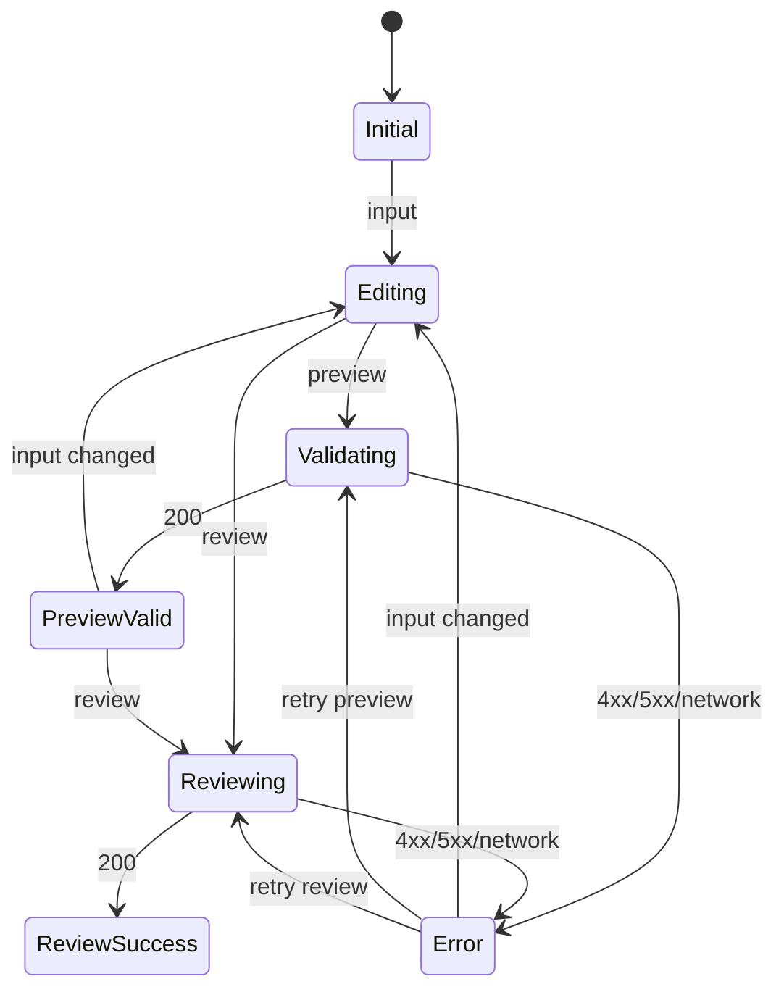

# Data Model: Preview Review Diff Validation

No persistent entity is introduced. The model is request- and page-local.

## ReviewDiff

| Field | Type | Rule |
|---|---|---|
| `text` | string | required, strict string, at least one code point |
| `length` | integer | Unicode code points; maximum 20 000 |
| `has_meaningful_content` | boolean | true when a non-whitespace code point exists |

Validation order is strict string schema, length, then meaningful content. Accepted
`text` is preserved exactly.

## PreviewResult

| Field | Type | Rule |
|---|---|---|
| `valid` | boolean | successful preview always returns true |

Failure uses the response status in the shared contract; no preview token is stored.

## ReviewResult

| Field | Type | Rule |
|---|---|---|
| `comment` | string | exactly one plain-text review comment |

## UiState

The page retains `ReviewDiff.text` across every transition. Both actions are disabled in
`Validating` and `Reviewing`.
