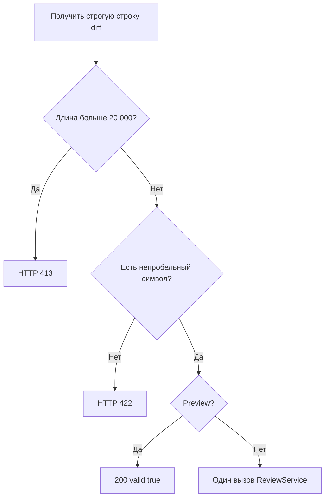

# Команда 2: согласованная спецификация логики

**Основа**: `before/logic-spec.md`  
**Контракт**: `contracts/shared-contract.md`  
**Статус**: согласовано до реализации

## Изменения после согласования

- Preview признан необязательным: ревью повторяет все проверки.
- UI полагается только на HTTP-статус ошибки.
- Уточнены Unicode code points, приоритет 413 и обработка HTTP 404 в UI.
- Зафиксировано отсутствие повторных запросов и безопасный вывод комментария.

## Правила API

1. `POST /api/reviews/validate` принимает ту же строгую модель `diff`, что ревью.
2. Схемная ошибка даёт 422 до вызова прикладной логики.
3. Длина проверяется раньше пробельного содержимого.
4. Строка длиной 20 000 принимается; 20 001 и больше отклоняется с 413.
5. Пустая и только пробельная строка до 20 000 отклоняется с 422.
6. Успешный preview возвращает ровно `{"valid": true}`.
7. Preview не вызывает `ReviewService.review` и LLM и ничего не сохраняет.
8. `POST /api/reviews` использует ту же функцию проверки и затем один раз вызывает
   сервис с исходным diff.
9. Ответ ревью остаётся `{"comment": string}`; MCP остаётся без изменений.

## Проверяемые границы

- `"test"`, `"  test  "`, Unicode и строка ровно 20 000 символов принимаются.
- Отсутствующее, числовое, пустое и пробельное значение дают 422.
- Строка из 20 001 значимого или пробельного символа даёт 413.
- Preview никогда не увеличивает счётчик вызовов LLM.
- После успешного preview настоящее ревью всё равно выполняет проверку и один вызов LLM.

## Алгоритм

