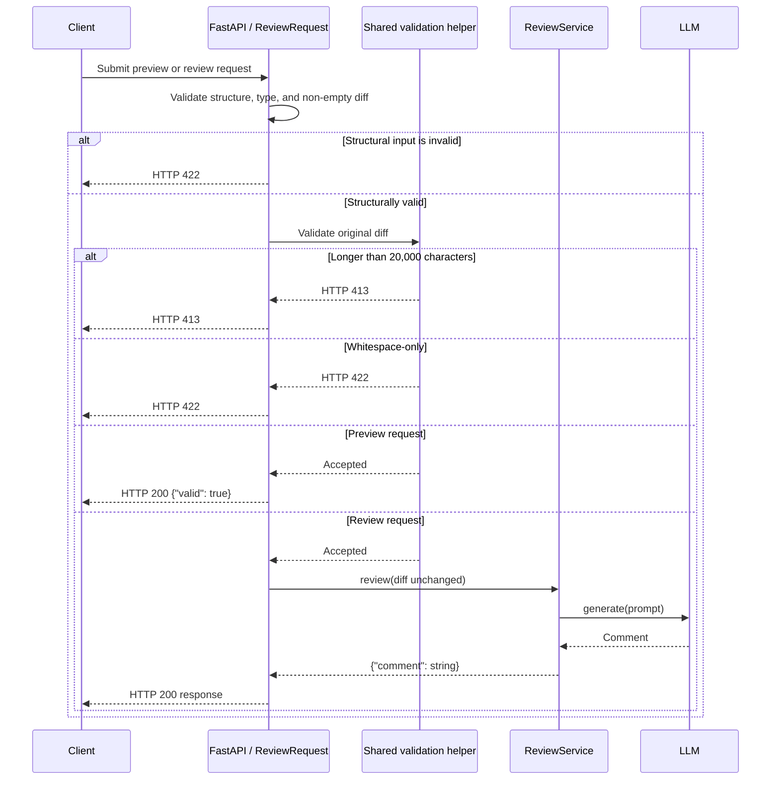

# Design

## Context

The current FastAPI route combines request handling with length and whitespace
checks before delegating accepted diffs to `ReviewService`. The MCP checker
reuses the same length constant and whitespace predicate. See `proposal.md` for
the motivation and the preview delta spec for the observable contract.

## Goals / Non-Goals

**Goals:**

- Keep preview and review validation behavior identical.
- Ensure preview validation cannot reach `ReviewService` or the LLM.
- Keep the validation order that gives oversized strings HTTP 413 before the
  whitespace rule is considered.

**Non-Goals:**

- Changing the existing review response or MCP tool contract.
- Adding persistence, authentication, or client-side validation.
- Returning a detailed validation report for accepted diffs.

## Decisions

### Share request validation between both HTTP operations

Keep `ReviewRequest` as the strict request schema and extract the length and
whitespace checks into one HTTP-facing validation helper. Both HTTP operations
call that helper, so their status codes and precedence cannot drift. The review
route continues to pass the unchanged diff to `ReviewService`; the preview route
returns `{"valid": true}` immediately after validation.

The two HTTP operations share the following validation flow:

The preview branch ends in the API and therefore cannot reach
`ReviewService` or the LLM.

Alternative considered: duplicate the two checks inside the preview route.
That is shorter initially but makes later rule changes easy to apply to only one
operation.

### Keep the preview operation in the existing application factory

Register `POST /api/reviews/validate` in `create_app` beside the review route.
This keeps dependency wiring unchanged and makes the absence of a service call
directly testable with the existing fake LLM.

Alternative considered: create a separate validation service. The current
validation is synchronous and stateless, so another service layer would add
indirection without isolating a meaningful dependency.

## Risks / Trade-offs

- [Risk] A future Pydantic schema change could affect both operations before the
  shared helper runs. → Mitigation: exercise both endpoints with the same invalid
  input table.
- [Trade-off] The preview route returns only success or the existing HTTP error,
  not a list of all issues. → Mitigation: keep error precedence deterministic and
  compatible with the review route.

## Migration Plan

Add the shared helper, switch the existing route to it, add the preview route,
and run the existing review tests before adding preview scenarios. Rollback
removes the new route and inlines the unchanged checks back into the review
route if necessary.
