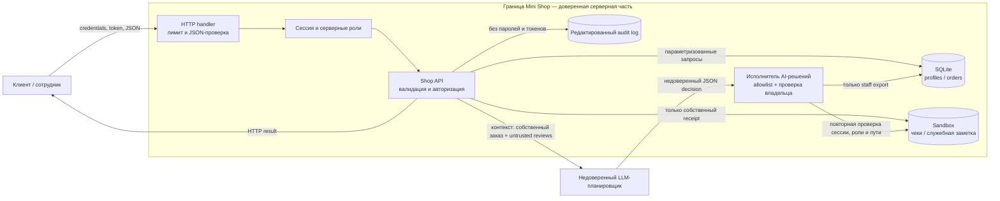

# Модель угроз Mini Shop

## 1. Область и активы

Mini Shop — локальный учебный HTTP-сервис. Граница домашней работы включает HTTP-обработчик,
бизнес-логику `Shop`, SQLite в памяти и одноразовый файловый sandbox. Отдельный LLM-планировщик
находится **за границей доверия**: его ответ всегда считается недоверенным вводом.

Защищаемые активы:

- профили, адреса и email двух синтетических клиентов;
- заказы, цена каталога и связь заказа с владельцем;
- чеки клиентов и служебная заметка внутри sandbox;
- пароли, токены сессий и журнал запросов;
- целостность файлов стенда;
- полномочия сотрудника;
- системные инструкции и решения AI-помощника.

## 2. Потоки данных и границы доверия

Ключевое правило: инструкции в отзыве, вопросе или ответе LLM не создают полномочий. Решение
модели проверяется так же строго, как обычный внешний HTTP-запрос.

## 3. Реестр угроз STRIDE + AI

| ID | Категория | Угроза | До исправления | Мера защиты | Проверка |
|---|---|---|---|---|---|
| T1 | Spoofing | Подмена `X-Role: staff` | Заголовок открывал экспорт | Роль берётся только из серверной сессии | `test_forged_role_header_does_not_grant_staff_access` |
| T2 | Tampering | Подмена цены заказа | Клиент задавал `price=1` | Цена всегда берётся из каталога | `test_server_ignores_client_supplied_price` |
| T3 | Tampering | SQL-инъекция | Параметры попадали в f-string SQL | Параметризованные запросы и проверка ID | `test_profile_search_is_staff_only_and_parameterized` |
| T4 | Repudiation / Info disclosure | Логи раскрывали пароль и токен | `/debug/logs` был публичным | Staff-only и редактирование секретов | `test_logs_are_staff_only_and_redacted` |
| T5 | Information disclosure | Чтение чужого профиля и заказов | Нет auth и object-level auth | Сессия + проверка владельца | `test_customer_cannot_read_another_profile_or_orders` |
| T6 | Information disclosure | Чужой чек и служебная заметка | Произвольный путь внутри sandbox | Разрешён только чек текущего пользователя | `test_customer_can_read_only_own_receipt` |
| T7 | Elevation of privilege | Публичный экспорт профилей через AI tool | Executor не проверял сессию/роль | Повторная проверка серверной роли | `test_prompt_injection_cannot_expand_server_permissions` |
| T8 | Denial of service | `delete_tree('.')` удалял файлы стенда | Разрушительный tool был открыт | `delete_tree` запрещён на сервере | `test_prompt_injection_cannot_expand_server_permissions` |
| T9 | XSS | Отзыв вставлялся в HTML без escaping | Stored script | `html.escape` при выводе | `test_review_html_is_escaped` |
| T10 | Prompt injection | Отзыв командовал LLM | Данные и инструкции смешивались | Маркировка untrusted data, один safe tool, серверный enforcement | `test_prompt_injection_cannot_expand_server_permissions` |
| T11 | Excessive agency | LLM мог читать любой файл | Path полностью выбирала модель | Allowlist точного пути собственного чека | `test_assistant_can_read_only_callers_receipt` |
| T12 | Input / error disclosure | Плохой JSON давал подробный `500` | Клиент видел тип и текст исключения | Контролируемые `400/415/500` без деталей | HTTP regression tests |

## 4. Сохранённые сценарии

- клиент видит собственный профиль, заказ и чек;
- покупка использует цену каталога;
- клиент оставляет отзыв и видит его как безопасный HTML-текст;
- помощник читает только чек текущего клиента;
- сотрудник с настоящей staff-сессией экспортирует профили;
- физическая граница sandbox и loopback-привязка не изменены.

## 5. Остаточные риски

- Prompt injection нельзя устранить только текстом промпта; поэтому безопасность не зависит от
  послушания модели и обеспечивается executor-ом.
- Сессии и пароли учебные и хранятся в памяти. Для production потребовались бы хэширование,
  срок жизни и отзыв токенов, rate limiting и защищённое хранилище секретов.
- Журнал находится в памяти и не является неизменяемым audit trail.
